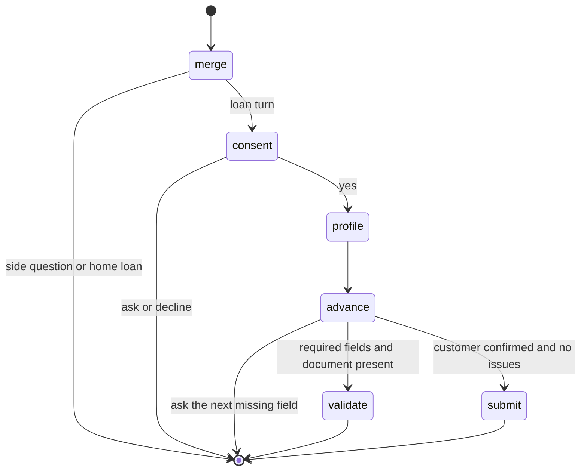
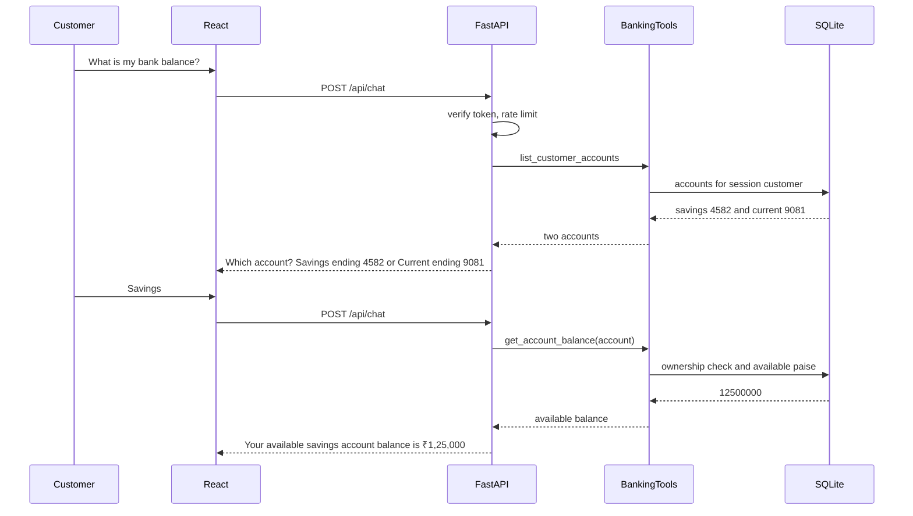
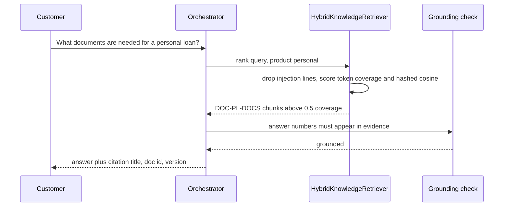
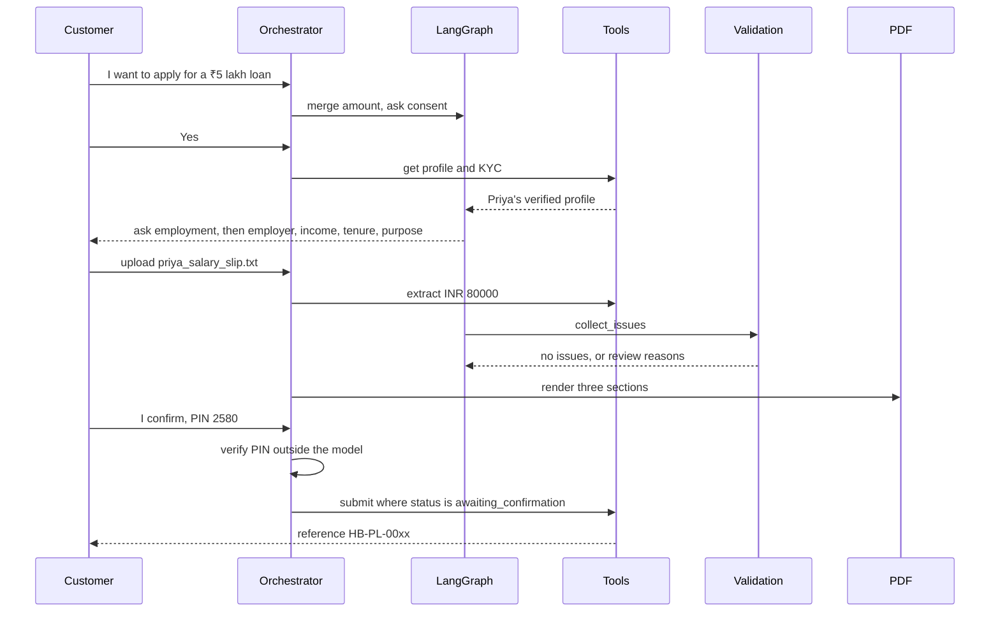
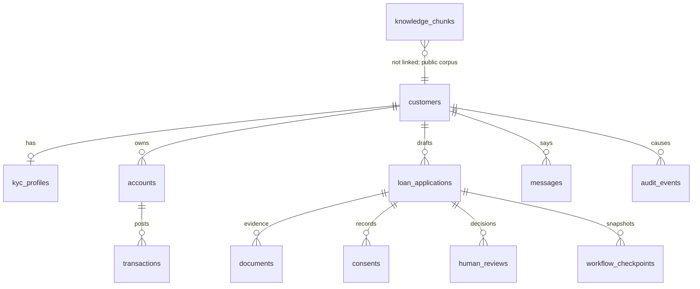

# Harbourline Assistant — architecture

Modular monolith for a fictional bank. One FastAPI process owns authentication, tools, retrieval, the loan graph, validation, PDF generation, and SQLite. The React client is a conversation and a read-only application view. It never fills a loan form.

The repository contained no existing three-form schema. The contract version is `poc-loan-v1`. A later adapter can map those fields onto a real core-banking payload without changing the graph.

All customer rows, balances, and policy pages are fictional and labelled as such.

## 1. Business requirement analysis

Customers already have a signed-in relationship with the bank. They ask three kinds of questions:

1. What is in my accounts?
2. What does the bank say about products and procedures?
3. Can I start a personal loan without sitting through three forms?

The bank still needs a typed application that matches its loan contract, a document the customer can read, an explicit confirmation, and a reviewer when the evidence disagrees with the profile. The assistant is a channel in front of those controls. It is not a second ledger and not a credit decision.

Success for this POC, checked by tests and by the running UI:

- "What is my bank balance?" returns the exact authorised available balance, and asks which account when the customer has more than one.
- "What documents are needed for a personal loan?" returns a cited answer from the approved personal-loan document page.
- "I want to apply for a ₹5 lakh loan" walks the conversation into a populated `poc-loan-v1` document that can be reviewed and submitted.

## 2. Functional and non-functional requirements

Functional:

- Mock sign-in, clearly labelled, with a customer or reviewer role.
- Balance and recent transactions only through tools whose customer id comes from the session.
- Retrieval over approved markdown with citations, abstention, and a clarification when personal and home loan pages both match and the question names neither.
- One open personal-loan draft per customer.
- Consent before the profile is copied into the draft.
- Document upload with text extraction. Salary figures that disagree with declared income pause for a reviewer.
- PDF generated from the validated object. The customer confirms with a demo PIN. Submission is idempotent.
- Audit events for tool use and decisions.

Non-functional:

- Money is integer paise. Display uses Indian grouping.
- No LLM-written SQL. The tool list has no `execute_sql`.
- No cross-customer reads. A balance tool has no customer-id argument.
- No submit while validation issues remain, consent is missing, or the PIN is wrong.
- Accounts can be switched off. The assistant then says the service is unavailable and does not invent a rupee amount.
- Rate limits are in-memory and suitable only for one process.

## 3. Assumptions and open questions

Assumptions locked for the POC:

- Bank name: Harbourline Bank. Currency: INR.
- Personal loan is the only product the graph will submit. A loan request that does not say "home loan" is stored as a personal loan, so "I want to apply for a ₹5 lakh loan" does not stop to ask which product. Home-loan pages are knowledge only, and an explicit home-loan application is explained and not submitted.
- Policy figures live in `backend/app/domain/policy.py` and are copied into the approved pages. Tests fail if the page text drifts from the code. They are not a real credit policy. The illustrative rate is 12.5% and is not a sanction.
- Age 21–60, salaried or self-employed, income at least ₹25,000, amount ₹50,000–₹15,00,000, tenure 12–60 months, amount at most 24 times monthly income, KYC verified, salaried applicants need a salary slip.
- Income is never inferred from transactions. A salary credit on the statement is not verified income.
- Step-up authentication is a demo PIN (PBKDF2, five failures lock the draft confirmation).
- Reviewer is required when income mismatches by more than 10%, names disagree, extraction confidence is low, or the employer name is missing. A clean application skips the reviewer and still requires the customer PIN.
- OCR is out of scope. A scanned image is rejected.
- Embeddings are a local hashed 256-dimension stand-in plus token coverage, behind `HybridKnowledgeRetriever`.

Open for a real bank, not guessed here:

- The actual three-form field names and enumerations.
- Which identity provider issues the session, and which step-up method replaces the PIN.
- The real product catalogue, pricing, and the credit-decision system behind submission.
- Which neural embedding model replaces the hashed vectors, and the evaluation set that would justify Qwen2.5 3B.

## 4. Existing versus proposed customer journey

Existing, as described in the brief: the customer opens three forms, retypes profile data the bank already holds, uploads documents on a separate screen, and submits.

Proposed:

```text
Sign in
  -> chat
       -> balance: clarify if needed, then exact available balance
       -> product question: cited page, or abstain
       -> "I want a personal loan of ₹5 lakh"
            -> consent
            -> profile copied from KYC (not retyped)
            -> employment, employer, income, tenure, purpose
            -> upload salary slip
            -> deterministic validation
            -> PDF preview (read only)
            -> reviewer only if evidence conflicts
            -> customer types PIN
            -> reference HB-PL-0001
```

The customer never sees a form. The application panel is read-only. The bank receives the typed contract.

## 5. High-level architecture

```mermaid
flowchart TD
  customer[Customer browser]
  ui[React TypeScript chat]
  api[FastAPI modular monolith]
  router[Deterministic intent router]
  tools[BankingTools facade]
  rag[HybridKnowledgeRetriever]
  graph[LangGraph loan flow]
  valid[Validation and contract]
  pdf[PDF generator]
  db[(SQLite fictional store)]

  customer --> ui
  ui -->|HTTPS JSON| api
  api --> router
  router --> tools
  router --> rag
  router --> graph
  graph --> tools
  tools --> valid
  tools --> pdf
  tools --> db
  rag --> db
```

```text
Customer
  |
  v
React chat + read-only application panel
  |
  v
FastAPI  /api
  |-- auth, consent, audit, rate limit
  |-- intent router (regex first, optional small model only if unknown)
  |-- BankingTools  (session customer id, 12 calls per turn, no SQL tool)
  |-- LangGraph     (loan transitions only; side effects stay in tools)
  |-- RAG           (approved markdown, citations, numeric grounding)
  v
SQLite  customers, accounts, transactions, drafts, documents, reviews, audit
```

## 6. Mobile-friendly dotted view

```text
[ phone ]
   |
   |  chat + application card
   v
( web ) ----> ( api ) ----> ( tools )
                 |             |
                 |             +--> ( accounts )
                 |             +--> ( kyc )
                 |             +--> ( loans )
                 |
                 +--> ( rag pages )
                 +--> ( loan graph )
                 |
                 v
              ( sqlite file )
```

Below 860px the UI stacks the transcript above the application card. The same `/api` routes serve both widths.

## 7. LangGraph loan workflow

The compiled graph is pure. Nodes return the next loan dict and a message. Persistence, PDF bytes, and submission happen in `BankingTools` after the graph returns, so a node cannot write SQL on its own.



`merge` writes only the field the assistant asked for, plus an amount or tenure the customer volunteered. A document-upload event skips slot filling so the filename cannot become an employer name. Profile fields are copied only after consent. `validate` runs `collect_issues`. `submit` is reached only when the draft status is `awaiting_confirmation` and this turn carries the confirmation flag set by a correct PIN outside the model.

One open draft per customer is enforced by a partial unique index. Statuses `submitted`, `rejected`, and `declined` are terminal and free the customer to start another application later.

## 8. Tool chain

`BankingTools.invoke` accepts only these names. Customer id is taken from the authenticated session.

| Tool | Authority |
| --- | --- |
| `list_customer_accounts` | Session customer. Masked numbers. |
| `get_account_balance` | Account must belong to the session customer. Returns available and ledger paise. |
| `get_recent_transactions` | Same ownership check. |
| `search_bank_knowledge` | Approved chunks only. |
| `get_customer_profile` / `get_customer_kyc` | After consent in the loan flow. |
| `get_loan_requirements` | Figures from `policy.py`, not from the model. |
| `extract_document_fields` | Regex over text or a PDF text layer. |
| `get_loan_draft` / `update_loan_draft` | The caller's open draft. |
| `validate_loan_application` | Deterministic issues. |
| `generate_loan_document` | reportlab from the contract object. |
| `request_human_review` | Moves the draft to `pending_review`. |
| `submit_loan_application` | Conditional update from `awaiting_confirmation` only. |

There is a 12-call cap per turn. Every call is audited. `get_account_balance` does not take a customer id, so a model cannot pass someone else's id.

## 9. Sequence: balance enquiry



Priya's ledger balance is ₹1,30,000. The spoken figure is the available balance, 12,500,000 paise. If `BANK_ACCOUNTS_ENABLED` is false, the tool raises unavailable and the reply contains no rupee amount.

## 10. Sequence: RAG



Coverage under 0.5 abstains. If personal-loan and home-loan chunks both score and the question names neither product, the assistant asks which product. Draft pages (`status` other than approved, or `access` other than public) are not indexed. A numeric claim such as a 0% rate that is not in the evidence is rejected.

An optional EMI illustration is computed in Python from the fictional 12.5% rate only when that rate is present in the retrieved page and the customer already gave an amount and tenure. The model does not do the arithmetic.

## 11. Sequence: conversational loan



A second confirmation after submit returns the same reference. A wrong PIN does not change status. ₹50 lakh fails validation because the fictional maximum is ₹15,00,000. Another customer cannot download the PDF.

## 12. Data model



`loan_applications` stores the draft as JSON plus promoted columns for status, review, and reference. A partial unique index allows only one row per customer whose status is not `submitted`, `rejected`, or `declined`.

Money columns are integer paise. Account numbers are stored for the seed and masked before they leave the API (last four digits).

## 13. API and tool contracts

Customer and reviewer JSON under `/api`:

| Method | Path | Who |
| --- | --- | --- |
| GET | `/health` | public |
| POST | `/auth/login` | public, rate limited |
| GET | `/me` | session |
| POST | `/chat` | customer |
| GET | `/conversations/latest` and `/conversations/{id}` | owner |
| POST | `/conversations/{id}/documents` | owner, open draft |
| GET | `/accounts` and `/accounts/{id}/balance` | owner; 403 otherwise |
| GET | `/loans/current` | owner |
| GET | `/loans/{id}/document` | owner; path is built from the id, not from a client filename |
| POST | `/loans/{id}/confirm` | owner, PIN |
| GET | `/reviews/pending` | reviewer |
| POST | `/reviews/{id}` | reviewer: approve, request_info, reject |
| GET | `/audit` | reviewer |

Chat response: `conversation_id`, `reply`, `intent`, `citations[{doc_id,title,version}]`, `tool_trace[{name,ok,detail}]`, `application`, `pdf_ready`, `actions` (`upload`, `confirm`).

Loan contract `poc-loan-v1`:

- `PersonalKycForm`: name, date of birth, email, phone, address, masked PAN, `kyc_status = verified`.
- `EmploymentLoanForm`: employment type, employer, monthly income paise, amount paise, tenure months, purpose.
- `ReviewSubmitForm`: consent, document reference, confirmation, optional reviewer decision.

`assert_submittable` refuses a payload that fails those types or the policy ranges.

## 14. Security and trust boundaries

```text
Untrusted: chat text, uploaded file text, retrieved page text, model output
   |
   |  cannot select SQL, change the system prompt, or name another customer
   v
Trusted boundary: FastAPI session
   |
   +-- customer id from the token
   +-- role customer | reviewer
   +-- PIN checked with PBKDF2 before the confirmation flag is set
   +-- tools reject account ids the session does not own
   +-- knowledge loader strips injection lines and skips unapproved files
   +-- numeric grounding rejects amounts that are not in the evidence or the tool payload
   v
SQLite, PDF renderer, submission update
```

The default JWT secret in `.env.example` is `poc-only-not-for-production`. Tokens are HMAC over subject and expiry. Secrets are redacted in audit payloads.

This is a demonstration boundary. It is not a penetration test, and it is not a substitute for a bank identity provider, mTLS to core banking, or field-level encryption.

## 15. Human-in-the-loop

Customer loop: the assistant asks one missing field at a time. The PDF is shown read-only. Submission waits for the words of confirmation and a correct PIN.

Reviewer loop: income mismatch above 10%, name mismatch, low extraction confidence, or a missing employer sets `pending_review`. The reviewer can approve, ask for information, or reject. Approval returns the draft to the customer confirmation step. Rejection is terminal. The customer cannot skip this with a PIN.

Clean applications do not wait for a reviewer. They still cannot submit without the PIN.

## 16. Lightweight LLM selection ADR

Status: proposed, not benchmarked.

Context recorded on this workstation (darwin 24.6.0): Apple M4 Pro, 12 CPU cores, 24 GB RAM, no discrete GPU bake-off, Ollama not installed.

Decision for the running POC: `BANK_LLM_PROVIDER=deterministic`. Intent uses the checked-in patterns in `app/agent/nlu.py`. Retrieval uses token coverage plus hashed embeddings. Money, validation, EMI, and submission never call a model.

Provisional model if a local server is added later: Qwen2.5 3B Instruct via Ollama's OpenAI-compatible API (`app/agent/llm.py`, default `http://127.0.0.1:11434/v1`, model id `qwen2.5:3b`). A 3B instruct model fits in 24 GB with room for SQLite and the dev servers, and it is small enough to keep temperature 0 for classification. The adapter may only return one of six intent labels, or paraphrase text whose numbers already appear in evidence.

Why this and not a larger model: the loan graph and the tools already decide the banking outcomes. A larger model would add latency and a wider instruction-following surface without owning any figure the bank must stand behind. Why not skip a model entirely in production: paraphrases and unseen phrasings are the only jobs left, and those still need an evaluation on the bank's own utterances before the provider flag changes.

Consequences: until that evaluation is run, the README must not claim model accuracy. The checked-in 30-phrase and 13-question sets measure the deterministic path only.

## 17. SOLID in this codebase

- Single responsibility. `policy.py` holds figures. `validation.py` collects issues. `pdf.py` renders. `nlu.py` labels. `loan_graph.py` transitions. `tools.py` is the only gateway that touches repositories on a customer turn.
- Open/closed. A real loan payload replaces `build_contract` / `assert_submittable`. A neural embedding model replaces the body of `HybridKnowledgeRetriever`. The graph nodes stay.
- Liskov. `HybridKnowledgeRetriever` is a LangChain `BaseRetriever`. Callers depend on `rank` and the retriever interface, not on the hashed vectors.
- Interface segregation. The chat API returns a small `ChatResponse`. Reviewer routes are separate from customer routes. Tools do not accept a free-form SQL string.
- Dependency inversion. Routes depend on repositories and `BankingTools`. The graph depends on plain dicts and pure functions. SQLite is behind the repository classes, which is the seam a Spring Boot client would occupy.

## 18. Error handling and recovery

| Failure | Behaviour |
| --- | --- |
| Unknown account or other customer's account | 403, no balance in the body |
| Accounts disabled | 503-style domain error, reply has no rupee amount |
| Knowledge below the coverage gate | Abstain, no invented policy |
| Upload that is not text or a text-layer PDF | Extraction confidence stays low; reviewer path if a draft exists |
| Wrong PIN | Status unchanged, failure counted, lock after five |
| Process restart | Draft, checkpoint, and messages are in SQLite. The next chat reloads the open draft. Covered by a test that uses two clients on the same data directory. |
| Double submit | Update is conditional on `awaiting_confirmation`. The second call returns the existing reference. |
| Validation issue | Graph stays on the draft and names the issue. ₹50 lakh is rejected against the ₹15,00,000 cap. |

Login failures roll back the request session, so a denial does not commit a partial customer row. In-memory rate limits reset when the process restarts.

## 19. Testing and evaluation

Command: `cd backend && .venv/bin/python -m pytest tests -q`

Latest run after the loan-graph upload guard: see the README measured-results line. The suite covers:

- INR grouping and lakh parsing
- Policy text locked to the eligibility page
- Exact balance strings, single-account shortcut, cross-customer 403, accounts-disabled with no rupee sign, balance tool signature
- 30 intent phrases and 13 retrieval cases, required to be at least 95% each
- Citation on the API, abstention, injection-line removal, draft pages skipped, chat injection that must not echo Priya's account number or balance
- Happy-path ₹5 lakh loan, wrong PIN, PDF text (Priya, Sharma, 5,00,000, "did not fill"), idempotent second confirm, income conflict through reviewer approval, restart recovery, ₹50 lakh rejection, other customer blocked from the PDF

What was not measured: latency, model quality, rate-limit windows, Docker, and a production-shaped load test. Do not treat 30/30 on the checked-in phrases as a field accuracy number.

## 20. Production migration

Keep the React channel and the LangGraph package. Replace the inside of the tools.

```text
Browser
  -> edge / API gateway (bank IAM, mTLS, WAF)
  -> this orchestration service (Python), or a thin BFF
  -> Java Spring Boot banking APIs
        accounts, KYC, documents, loan origination
  -> Postgres for drafts, checkpoints, audit (not the ledger)
  -> object store for PDFs
  -> approved knowledge index (bank content platform)
  -> reviewer workbench the bank already uses
```

The orchestration service calls Spring Boot the way it calls repositories today. It does not gain a SQL tool. Submission remains a command to the origination API after the same confirmation and validation gates.

Before production:

- Replace mock passwords, the demo PIN, and the default JWT secret with the bank IdP and step-up.
- Move drafts and audit to Postgres. Keep balances on the core ledger only.
- Replace hashed embeddings and run the bank's evaluation set before enabling any model.
- Add OCR only behind a trusted extraction service whose output is still validated, not trusted.
- Put rate limits and idempotency keys in a shared store.
- Pen-test file upload, token lifetime, and reviewer authorisation.
- Cost: one small orchestration service plus existing Spring Boot capacity. A 3B model is optional and should be on-prem if customer text cannot leave the bank.

SQLite in this POC is a file the process can rewrite. It is not a production ledger and must not be described as one.
